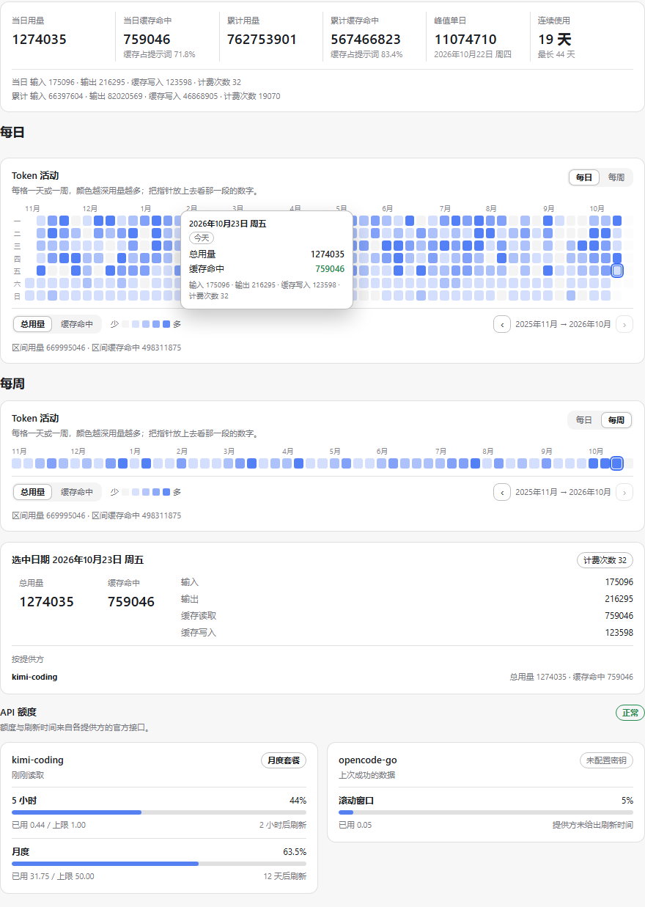
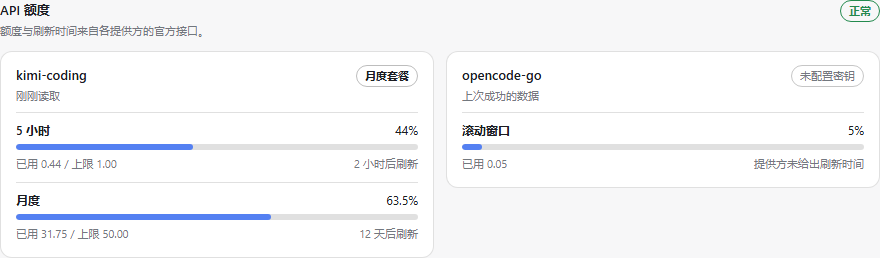
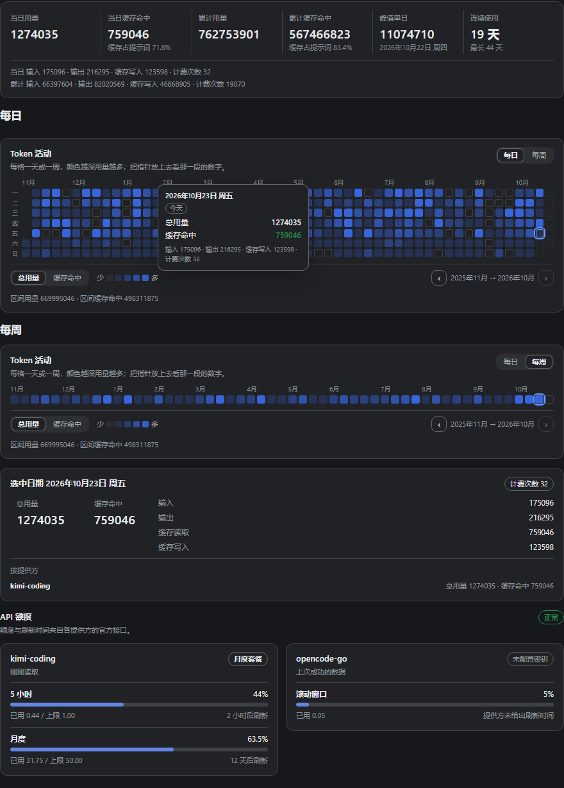

# 用量 · dsh-usage

[中文](README.md) | [English](README.en.md)

> DeepSeek Harness (DSH) 设置面板里的 **用量** 页：当天与累计的 token 用量、缓存命中、
> 近六个月的热力图，以及本 Harness 已接入 API 的额度与刷新时间。
> 累计账本存在**每用户数据目录**，卸载插件或重装 DSH 都不会丢。



插件注册在 `settings.section`，名为「用量」，排在 **Agent 预设** 下面，图标为自绘的三柱折线。

## 最近更新（1.6.0）

- 账本迁到**每用户数据目录**（Windows `%LOCALAPPDATA%\dsh-usage\`，macOS `~/Library/Application Support/dsh-usage/`，
  Linux `$XDG_DATA_HOME/dsh-usage/`）：卸载插件、卸载或重装 DSH 都不会删除，下次安装自动继承。
- 首次加载把 1.5.0 旧账本（`$DSH_HOME/usage-ledger/`）合并进来，旧文件原样保留。
- 另修「已删除会话」标记没写进账本、导致计数偏小的问题。

## 先装 DSH 桌面端

本插件住在 Harness 里，所以先把桌面端装上。官方下载页是
[deepseek.com/download](https://www.deepseek.com/download/)，页面里的 **DeepSeek Harness 桌面端** 提供：

| 平台 | 安装包 | 要求 |
|---|---|---|
| macOS | [dsh-latest-macos-arm64.dmg](https://download.deepseek.com/desktop/dsh-latest-macos-arm64.dmg) | Apple 芯片、macOS 13 或更高版本（Intel 芯片暂不支持） |
| Windows | [dsh-latest-windows-x64.exe](https://download.deepseek.com/desktop/dsh-latest-windows-x64.exe) | 64 位 Windows |

产品介绍见 [deepseek.com/harness](https://www.deepseek.com/harness/)；源码、文档与快速开始见
[GitHub · deepseek-ai/deepseek-harness](https://github.com/deepseek-ai/deepseek-harness) 与
[guide/quickstart](https://deepseek-harness.github.io/deepseek-harness/guide/quickstart)。
桌面端支持后台运行与本地文件读写——本面板折叠出来的用量数字，就来自它写在本机会话日志里的记录。

## 安装

这是一个标准的 DSH bundle（`package.json` 里声明了 `dsh.bundle.patch` 与 `dsh.client`），
可以直接从 GitHub 装进桌面端，不用先手动下载插件包：

1. 打开 **DSH 桌面端** → 左侧 **插件** → **添加插件** → **安装第三方插件**；
2. 在「包名或地址」里填本仓库地址 `https://github.com/linanbuan/dsh-usage`
   （这个输入框也接受 npm 包名与本地目录的绝对路径）；
3. 点 **安装**，按提示**重启 DSH** 让 Host 半加载。

也可以先把仓库取到本机，再把**解压目录的绝对路径**填进同一个输入框：

```bash
git clone https://github.com/linanbuan/dsh-usage.git
# 或者在 GitHub 页面点 Code → Download ZIP，解压后使用解压目录
```

在会话里让 Agent 安装、或在已配置 `dsh` 命令的终端里安装，也都是等价方式：

```text
plugin_manager   action: install_bundle   target: <本目录的绝对路径>
```

```bash
dsh plugin --profile <你的 profile> add <本目录的绝对路径>
```

它会执行 pnpm 置入并把 `@local/dsh-usage` 写进 profile 的 `dsh.profile.bundles`。
从 1.5.0 升级时请先卸载旧版再安装新版（第三方插件不支持原地更新）；旧账本会在第一次启动时自动继承。

装好后 **Host 半需要重启 Harness 才生效**（Host 模块走 Node 的 ESM 缓存，不参与 HMR）；
浏览器半由 HMR 立刻更新。想关掉它，在 profile 自己的 `cordis.patch.yml` 里覆盖这一行：

```yaml
- id: usage-panel
  disabled: true
```

## 它显示什么

| 区块 | 内容 |
|---|---|
| 概览条 | 当日用量、当日缓存命中、累计用量、累计缓存命中（附缓存占提示词的百分比）、峰值单日、连续使用天数与最长记录；下面一行写明账本自何时起累计、上次更新于何时、以及 `本机现存日志` 折算出的数字 |
| 累计的来历 | 累计与热力图来自本机账本（见下一节）：账本在每用户的数据目录里，卸载插件或重装 DSH 都带不走；会话被删除后不再被读取，但已记下的用量不会从累计里消失 |
| 历史用量 | 近六个月的热力图：一格一天，切到 **每周** 后一格一周；颜色越深用量越多，把指针（或用键盘聚焦）放到格子上浮出那一天或那一周的用量与缓存命中；点一格在下方看完整明细，左右按钮翻十二个月 |
| API 额度 | `kimi-coding`（五小时窗口、总额度）、`commandcode`（五小时、每周、总额度）与 `opencode-go`（滚动五小时、每周、总额度）的已用比例与刷新时间 |

热力图的分档按 **当前窗口内的分位数** 现算（40%、65%、85%），所以同一天在同一窗口里颜色始终一致，
换了窗口或切到缓存命中口径时也会重新分档——它表达的是「相对这几天/这几个月里算多还是算少」，
不是固定的绝对值刻度。颜色只区分深浅，数字永远以完整整数出现在浮层和明细里。

用量数字一律以 **完整整数** 显示，不做 `K` / `M` / `B` 之类的缩写。

`commandcode` 的量按 **百分比** 显示，不显示金额：它的每个模型各有自己的金额上限，同一个「还剩多少美元」在不同模型上能干的活并不一样，所以那个数字不可比。可比的只有「这个窗口已经用掉多少比例」，因此面板只报比例。本计费周期的上限由 **已用 + 剩余** 现场推导（对任何套餐都成立），只在接口没给剩余值时回落到公开价目表；`kimi-coding` 原始接口本身就返回比例，照旧。

`opencode-go` 的接口（`https://opencode.ai/zen/go/v1/usage`）本身就按窗口返回 `percent` 与 `resetsAt`，照原样显示。它的三个窗口是三个独立的上限（套餐口径：五小时 = 月度上限的 20%，每周 = 50%，每月 = 100%），所以在都是 0% 的账户上也保持三行，不会因为比例相同被合并。凭据库里的键名是 `OPENCODEGO_API_KEY`，套餐名（Go / Go Plus）接口不返回，卡片不显示套餐行。



## 累计用量与账本

累计数字不是「把现在磁盘上的会话日志加一遍」，而是记在一份本机账本里。账本放在**每用户的操作系统数据目录**，
刻意不放在插件目录，也不放在 DSH 的 home 里——这两处都可能随卸载 / 重装动作被删除或替换，而用量历史要比它们活得久：

```text
Windows   %LOCALAPPDATA%\dsh-usage\ledger.json      # 未设置时回落 %APPDATA%，再回落 %USERPROFILE%\AppData\Local
macOS     ~/Library/Application Support/dsh-usage/ledger.json
Linux     $XDG_DATA_HOME/dsh-usage/ledger.json      # 缺省 ~/.local/share/dsh-usage/ledger.json
```

同目录还有两个文件：

```text
ledger.json.bak   上一次成功写盘的副本
imported.json     旧账本的导入记录（每个旧文件的 size + mtime）
```

`DSH_USAGE_LEDGER` 仍可覆盖账本位置，给的是**完整文件路径**；`DSH_HOME` 不再影响账本落在哪，profile 的配置也搬不动它。

**卸载不会带走这份账本。** 移除 bundle、卸载或重装 DSH 都不会自动删除这个目录，所以下一次安装读到的是同一份文件、
接着往下记：重装 DSH 会开一个新的 home 与一批新会话，旧会话的行标成「已删除」继续计入累计，新会话照常加入，
累计只增不减。

从 1.5.0 及更早的版本升级时，旧位置的账本会被**合并**进来，原文件不移动也不删除。旧位置是
`$DSH_HOME/usage-ledger/ledger.json` 与 `~/.dsh/usage-ledger/ledger.json`（`DSH_HOME` 未设置时两者是同一个文件，
设成别处时两个 home 都看）；合并按会话取「读得更多」的那一行、起始时间取更早的，`imported.json` 记住每个旧文件的
大小与修改时间，所以同一个版本只导入一次——旧文件以后又被旧版 Harness 推进了，下一轮才会再次合并。

账本按会话一行，记住它贡献过的每日用量，以及日志读到了第几条。于是：

- **删掉会话不会让累计变小。** 日志消失的那一轮只给它打上 `goneAt` 标记，那一行的用量继续算进累计；
- **增长只读增量。** 每条会话的 `revision` 没变就一次都不打开，变了只从上次的位置往后读；
- **异常只报不回退。** 日志变短、被重排、读不出来时，那一轮跳过并写进面板底部的告警，已记的数字不动；
- **每 10 分钟自动记一次**（可用 `syncIntervalMs` 改，最小 60 秒），面板刷新会立刻推进一次；
- 写盘是「临时文件 + 改名」，并保留 `.bak`；同时开两个窗口时按会话取「读得更多」的那一行合并，不会互相覆盖成重复计数；
- **会话 id 换拼写也不会记成两笔。** 宿主早期的 id 是裸 UUID、后来带 `session-` 前缀，同一台机器上两种都可能有：
  账本按目录名原文记键，遇到「同一会话、另一种拼写」时把那行*改名*（用量保留），写盘合并时再把成对的拼写折成一行。

概览条下面那行 `本机现存日志 …` 就是同一批数据里「日志还在磁盘上」的那部分。累计比它多出来的，
正好是已经删掉、但账本仍然记着的那些会话——这就是这两个数字的差该怎么读。把指针停在那行上，
浮层会写出账本文件的完整路径，并说明卸载插件或重装 DSH 都不会丢。

想把账本清零（累计从当下重来），删掉 `ledger.json` 与 `ledger.json.bak` 即可：`imported.json` 会拦住旧账本，
升级前的历史不会因为删了新文件而重新长回来。确实要从旧账本再导入一次，才需要连 `imported.json` 一起删掉。

### 补齐旧账本 / 从备份补记

`tools/seed-ledger.mjs` 用与面板完全相同的折叠代码，在没有 Harness 的情况下推进账本：

```bash
node tools/seed-ledger.mjs                      # 用本机会话日志建账 / 推进（Host 不在时）
node tools/seed-ledger.mjs --backfill --from <备份的 sessions 目录>
```

它用的也是上面那个缺省路径，并同样会把旧位置的账本继承进来。

`--backfill` **只加不改**：备份里有、账本里没有的会话会作为「已消失」的行补进来（不复制、不恢复任何会话文件），
已经在账本里的会话原样不动，所以重复执行没有副作用。想先看结果就加 `--dry-run`。

数据模型、同步算法、只增不减的边界，以及为什么不用 SQLite，见 [docs/token-ledger.md](docs/token-ledger.md)；
这套改动踩过哪些坑（删除会话、id 拼写换代、profile 的 `link:` 依赖）记在 [docs/project-log/log.md](docs/project-log/log.md)。

## 速度

面板从不等人。两个半边的代价差了三个数量级，所以它们是分开请求的：

| 半边 | 实测 |
|---|---|
| 本地数据（读本机账本，日志只在变长时读尾部） | 建账 2.7 秒，建好之后 1–50 毫秒 |
| 提供方额度（一次海外往返） | 通常 0.2 至 2 秒，抖动时可到 10 秒 |

因此：

- 概览条和热力图在本地数据到达时就画出来，额度区块自己在后面填；
- 五个提供方请求 **并发** 发出（此前是「kimi 然后 commandcode」两段串行，等于付两次往返；`opencode-go` 后来加入，同样是并发）；
- 额度结果按 90 秒新鲜度直接返回，过期时先给旧值再后台更新，页面拿到 `refreshing` 后自行回来取；
- 插件激活 2.5 秒后预热一次缓存，之后每 5 分钟后台刷新，**打开设置通常就是缓存命中**；
- 累计用量读的是本机账本：**空闲时一次日志都不打开**（149 个会话实测：同步 2 毫秒、含请求的端到端 49 毫秒），日志变长时只读新增的尾部。

网络抖动不放大成「读取失败」：每个读取有 **20 秒** 独立时限，超时或掉线 **重试一次**（重试自己带一个新时限，两个请求都是幂等的 GET）；两轮都没成时，**上一轮的好数字会留下来**并标注「上次成功的数据 + 时间 + 这次为什么失败」，而不是把整张卡片清空。这条不是理论——本机到 `api.commandcode.ai` 平时 230–900 毫秒，却在同一个下午量到过 10.5 秒的连接超时与 9.4 秒的响应，旧版的 8 秒时限就是这么把卡片变成「提供方未在时限内应答」的。



## 口径

- 总用量 = 输入 + 缓存读取 + 缓存写入 + 输出，与 `@deepseek-ai/dsh-token-meter` 一致：
  一条计费记录的 `inputTokens` 是 **未命中缓存** 的提示词部分，所以缓存命中不会被重复计算。
- 缓存命中 = 该口径里的缓存读取部分。
- 按天归档使用 **本机时区** 的日历日；热力图的「每周」按 ISO 周（周一到周日）折叠。
- 数据来源是 Host 的 `sessionPersistence` 服务（不自行解析压缩的会话日志文件），折叠进本机账本后由面板读取。

## 结构

```
package.json       bundle 清单（dsh.bundle.patch + dsh.client）
cordis.patch.yml   一行 insert：装载 Host 半
index.js           Host 半：/api/usage/usage、/api/usage/quota、/api/usage/report
client.js          浏览器半：settings.section 页面（无构建步骤的懒 CJS bundle）
lib/ledger.js      增量账本：折叠、同步、合并、原子读写；账本路径与旧账本继承
tools/seed-ledger.mjs  在没有 Harness 时建账 / 从备份补记（同一个缺省路径）
icon.svg           bundle 图标
locale/*.json      插件清单里的标题与说明
docs/              面板截图（由 test/preview.mjs 的静态渲染产出）、账本方案与项目日志
  token-ledger.md  账本的数据模型、同步算法与边界
  project-log/     项目日志（按 AGENTS.md 只追加）
test/selfcheck.mjs 激活自检
test/preview.mjs   静态预览：把真实组件树渲成 HTML，用于看布局与色阶
```

## 隐私

- 提供方密钥只从 Harness 自己的凭据库解析，**始终留在 Host 侧**，浏览器只拿到响应体；
- 额度来自提供方自己的官方接口，不读第三方 CLI 的私有文件、不碰浏览器 Cookie；
- 本仓库不含任何密钥、账号标识或本机路径。

## 自检

```bash
node test/selfcheck.mjs      # 或 pnpm test
```

在 Node 里按插件系统的方式装载两个半边、用桩上下文激活，并离线跑通三条路由，逐项断言：
导出形态、路由形状与路径唯一性、无凭据时的降级响应、token 折叠口径、提供方解析、
一次超时确实只重试一次、两轮都失败时保留上一轮的好数字并带上失败原因、
配置态（删掉密钥）不会被旧数字盖住、五个请求确实并发、本地半边不触碰网络，
以及 section 的 id / order / label / 组件类型。账本单独一节断言「只增不减」的全部不变量：
建账与全量折叠相等、未变化的会话一次都不打开、增长只记一次、删除后累计不变、恢复回来只记新增、
变短与重排只告警不回退、两份账本合并取「读得更多」的一行、损坏文件回落到 `.bak`，以及概览条那行账本说明的文案。
1.6.0 起另加存储位置与继承的断言：三个平台的缺省路径、`DSH_USAGE_LEDGER` 覆盖、`DSH_HOME` 不再影响落点、
旧位置的账本只导入一次、删账本不会让旧历史复活，以及卸载插件 + 重装 DSH 后累计不变。
浏览器半另外断言热力图的窗口、周列、ISO 周、分档、周聚合、连续天数，和渲染树里的格子数、
`aria-label`、图例与分段开关。全部通过即退出码 0。

想只看样子、不想开 Harness：

```bash
node test/preview.mjs        # 写出 .local/preview/{light,dark}.html，浏览器打开即可
```

它用同一份 CSS 和同一棵真实组件树渲成静态页，只有主题变量是页面自己给的；
`docs/` 里的截图就是这么截的（悬停浮层一份是按同一样式手工摆位的样张）。

## 致谢

设置左栏「自己画图标并让 shell 的兜底图标让位」这一手法，与 MIT 许可的
[`commandcode-dash`](https://github.com/Momonaka/commandcode-dash) 采用的是同一思路。

## License

[MIT](LICENSE) © linanbuan
